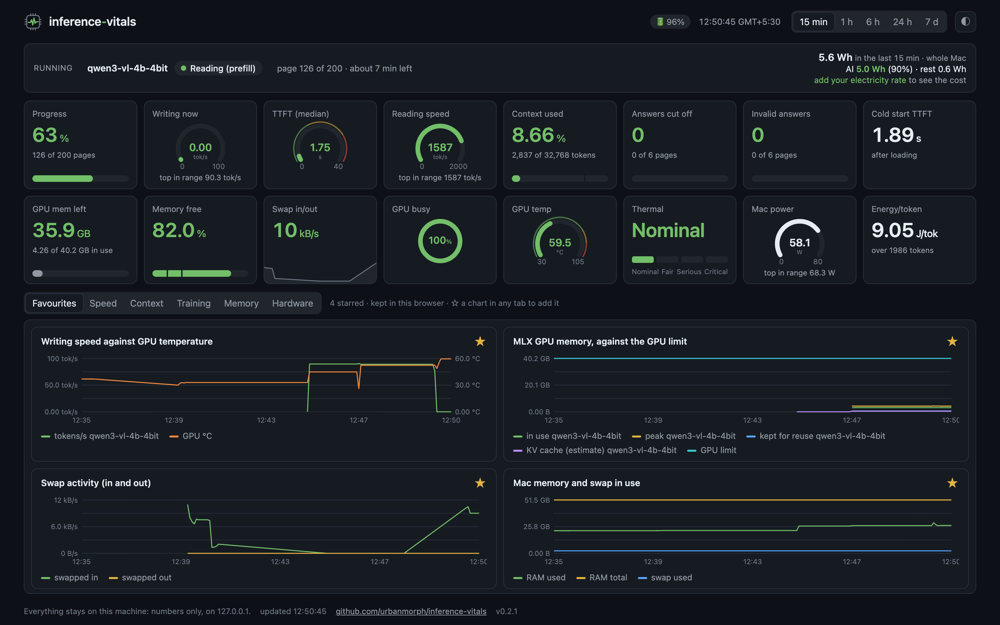
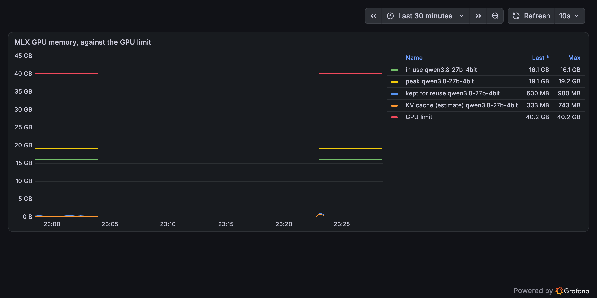
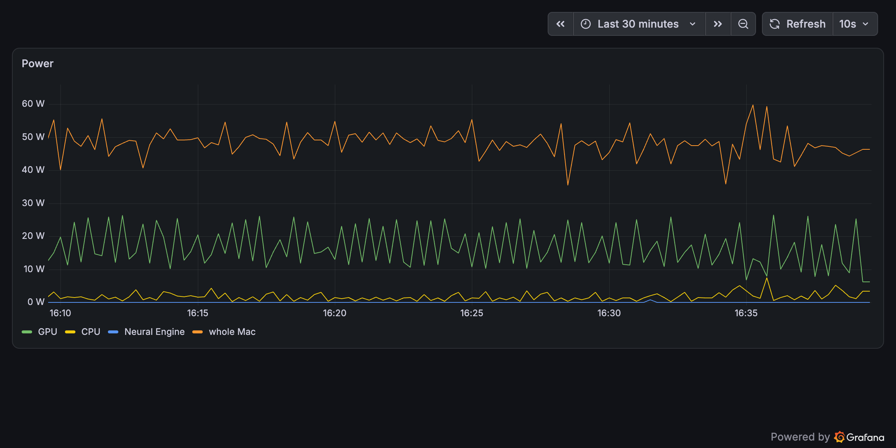
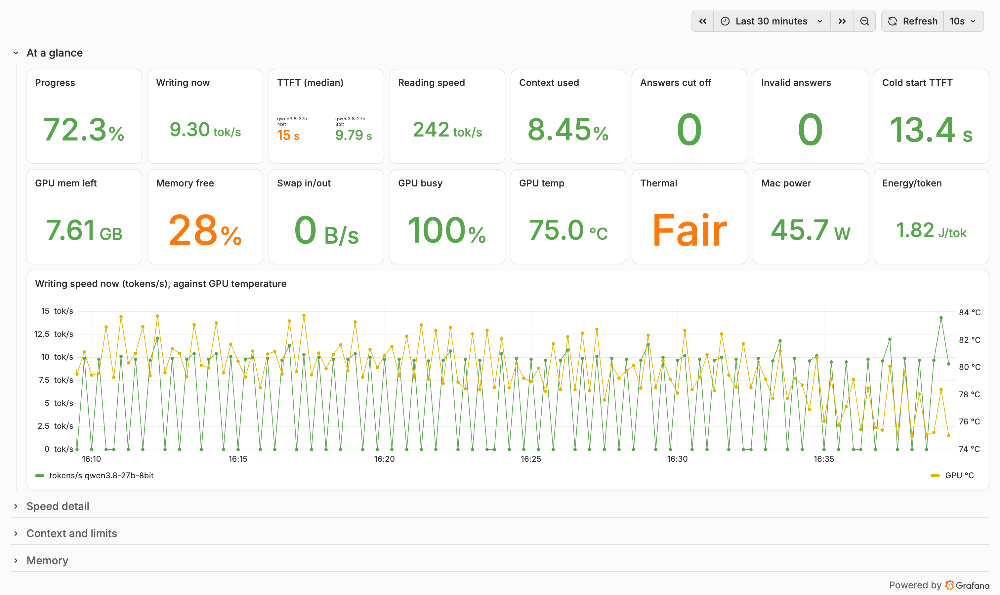

# inference-vitals

**One screen for running AI models on an Apple Silicon Mac, or on Linux with NVIDIA GPUs (experimental):
how fast the model is, how close it is to running out of memory, and how hot the machine is getting, on
the same timeline.**



Activity Monitor makes you switch tabs and knows nothing about models. Benchmark apps time the requests
they send themselves. inference-vitals sits beside whatever you are running and records both sides, the
model and the Mac, so you can see *why* a run slowed down: the GPU got hot, macOS started swapping, or
a page was simply longer.

It works with **any model and any local engine**: Ollama, LM Studio, llama.cpp, the MLX servers, Jan,
LocalAI, or your own Python code. A small proxy in front of the engine measures each request as it
streams through; your code can also report directly.

It is [Prometheus](https://prometheus.io) and [Grafana](https://grafana.com) with a ready-made dashboard,
[macmon](https://github.com/vladkens/macmon) for the chip on a Mac (on Linux, a small exporter that reads
`nvidia-smi`), a small exporter for memory, the proxy, and a tiny Python library, with no dependencies
beyond Python itself. Everything runs on your machine and listens on `127.0.0.1` only.

## What it shows

**At a glance**, sixteen numbers, each with a quiet trend line under it, and one chart:

| The run | The machine (Mac; differences on Linux below) |
| --- | --- |
| **Progress** through the current run | **GPU mem left**: memory left before macOS's limit for the GPU |
| **Writing now**: tokens per second, live, while the answer is written | **Memory free**, macOS's own memory-pressure level |
| **TTFT (median)**: time to first token | **Swap in/out**: bytes moving to and from swap right now |
| **Reading speed**: prompt tokens per second | **GPU busy** |
| **Context used** against the limit you set | **GPU temp** (amber at 85 °C, red at 95 °C) |
| **Answers cut off** at the token limit | **Thermal**: macOS's thermal state, live: Nominal, Fair (warm), Serious (slowing down), Critical |
| **Invalid answers** (not the format you asked for) | **Mac power**, the whole machine, in watts |
| **Cold start TTFT**: the first answer after loading | **Energy/token**: joules per answer token |

On Linux with NVIDIA, the machine column changes where the hardware differs: **GPU mem left** is free
VRAM (summed over GPUs), **GPU slowdown** replaces Thermal (the GPU's own reasons for running below full
speed: None, Power cap, which is normal under full load, Thermal, Hardware), **GPU power** replaces Mac
power, and **Energy/token** counts the GPUs only. The folded sections show VRAM used against total per
GPU, GPU power against its limit, GPU and CPU temperatures, clocks, slowdown and fan speed.

The chart plots writing speed against GPU temperature, which is usually the first thing to look at
when a long run slows down.

Below that, four sections stay folded until you open them:

- **Speed detail**: TTFT per answer, median and 95th percentile, prefill and decode speed, model load time.
- **Context and limits**: context used per answer against the limit; prompt, cached and answer tokens.
- **Memory**: model memory (in use, peak, kept for reuse, KV cache estimate) against the GPU limit;
  swap activity; memory pressure.
- **Hardware**: GPU, performance and efficiency core use; GPU, CPU, Neural Engine and whole-Mac power;
  temperatures; clock speeds; thermal state; fans.

| Memory against the GPU limit | Power |
| --- | --- |
|  |  |

There is a light theme too: add `&theme=light` to the address.



## Install

You need an Apple Silicon Mac (M1 or later) with [Homebrew](https://brew.sh).

```sh
brew install uv prometheus grafana macmon
git clone https://github.com/urbanmorph/inference-vitals.git
cd inference-vitals
uv run inference-vitals start
open http://127.0.0.1:3000/d/inference-vitals
```

`start` writes the configuration, starts the four services below (each only if it is not already
running) and waits until each one answers. `uv run inference-vitals status` shows what is running;
`uv run inference-vitals stop` stops all four.

| Service | Address | What it does |
| --- | --- | --- |
| macmon (Mac) or the NVIDIA exporter (Linux) | `127.0.0.1:9091` | Chip numbers: GPU (and on a Mac, CPU) use, clock speeds, power, temperatures, fans. No `sudo`. |
| Memory exporter | `127.0.0.1:9092` | Swap activity, free memory and swap in use (and on Linux, CPU use and temperature), from `vm_stat` and `sysctl` or `/proc`. |
| Prometheus | `127.0.0.1:9090` | Reads everything every 5 seconds and keeps 30 days of history. |
| Grafana | `127.0.0.1:3000` | The dashboard, view-only. Sign-in is switched off (Grafana still shows the button); change the dashboard in `monitor.py` instead. |

Nothing starts by itself at login; run `start` when you want to watch something.

### Linux with NVIDIA GPUs (experimental)

Written and tested against recorded `nvidia-smi` and `/proc` output, not yet on real NVIDIA hardware: if
you run it, please open an issue with what you see. You need the NVIDIA driver (which brings
`nvidia-smi`), [uv](https://docs.astral.sh/uv/), Prometheus and Grafana:

```sh
# Prometheus: your distribution's package (Debian/Ubuntu: sudo apt install prometheus) or the release
# tarball from prometheus.io; only the `prometheus` binary needs to be on your PATH.
# Grafana: Grafana's own package repository (https://grafana.com/docs/grafana/latest/setup-grafana/installation/)
# If the packages start their own services, stop them first (sudo systemctl disable --now prometheus grafana-server):
# inference-vitals runs its own copies on 127.0.0.1 with its own settings.
git clone https://github.com/urbanmorph/inference-vitals.git
cd inference-vitals
uv run inference-vitals start
xdg-open http://127.0.0.1:3000/d/inference-vitals
```

On Linux the chip exporter on `127.0.0.1:9091` reads `nvidia-smi` instead of running macmon, and the
memory exporter reads `/proc` (memory, swap, CPU busy share) and the CPU's own temperature sensor. Without
`nvidia-smi` the GPU numbers stay empty and the rest still works. The proxy works the same on Linux; it
never cared which machine it runs on. Windows is not supported (under WSL2, the Linux route may work).

## Getting the model's numbers on it

The Mac half of the dashboard works on its own, whatever is running. The model half fills in when
something reports to `127.0.0.1:8400/metrics`, the address Prometheus reads. There are two ways.

### Any engine with an HTTP API: the proxy

```sh
uv run inference-vitals proxy --to http://127.0.0.1:11434   # Ollama
uv run inference-vitals proxy --to http://127.0.0.1:1234    # LM Studio
uv run inference-vitals proxy --to http://127.0.0.1:8080    # llama.cpp server, mlx-lm / mlx-vlm server
```

Then point your app at `http://127.0.0.1:8401` instead of the engine. Every request goes through
unchanged and every reply streams back unchanged; on the way, the proxy measures time to first token,
tokens per second (live, while the answer is written), token counts, answers cut off at the token limit,
and requests the engine refused. Each model gets its own line on the charts, named from the request's
`model` field (a model given as a file path is named by its folder only).

It understands the OpenAI-style `/v1/chat/completions` and `/v1/completions`, which almost every local
engine offers, and Ollama's own `/api/chat` and `/api/generate`. When the engine reports exact counts
and timings (OpenAI `usage`, llama.cpp `timings`, Ollama's counts and durations), those are used;
otherwise tokens are counted as they stream in, which is close but not exact.

What a proxy cannot see is the engine's own GPU memory, so "GPU mem left" and the model memory chart
stay empty; the Mac's memory, pressure and swap panels still show everything. "Progress" also stays
empty, since a proxy does not know how many requests are coming.

### Your own Python code: the library

Any engine (MLX, llama-cpp-python, PyTorch, a loop over an API), no extra packages:

```python
from inference_vitals.metrics import Metrics, serve

live = Metrics(total=len(pages), kv_per_token=0, labels={"model_name": "qwen3-8b-4bit"})
serve(live, 8400)

for page in pages:
    live.started(page)
    # ... while the answer streams in:
    live.progress(tokens=n_tokens_so_far, writing_seconds=seconds_since_first_token)
    live.finished(
        {
            "ttft_s": 1.8,
            "seconds": 21.0,
            "prompt_tokens": 2900,
            "generation_tokens": 310,
            "prompt_tps": 300.0,
            "generation_tps": 15.4,
            "peak_memory_gb": 19.1,
            "gpu_memory_limit_gb": 40.2,
            "context_used_tokens": 3210,
            "context_limit_tokens": 32768,
            "finish_reason": "stop",
            "parse_error": None,
            "warm": True,
        }
    )
```

Every field is optional; panels for fields you do not send stay empty. The `model_name` label puts each
model on its own line, so two runs can be compared on the same chart. `kv_bytes_per_token(config)` works
out the KV cache estimate from a model's `config.json`, including models that mix full and linear
attention layers.

This route can report everything, including the model's GPU memory and the context limit, so every
panel fills in. The proxy and the library both publish on port 8400, so run one at a time. The metric names follow vLLM's where one exists, so dashboards built for vLLM can read
them too.

Both routes carry numbers only. Prompts, answers and item ids never reach the numbers page, because any
program on the Mac can read `127.0.0.1`; the proxy does not store or log what passes through it.

## Run conditions

`inference_vitals.conditions.snapshot()` (macOS only, for now) returns what the Mac was doing at a moment: thermal and
performance warnings, the CPU speed limit, mains or battery, the power mode, the GPU memory limit setting,
the macOS version, and any process using more than 20% CPU (by name only). Store it with your results:
a slow run on a hot or busy Mac then explains itself. Spotlight indexing and Photos analysis
(`mediaanalysisd`) on a new Mac are common culprits.

## Overhead

The four services take a few hundred MB of memory between them and very little CPU. An open dashboard
tab also redraws its charts every 10 seconds. That is small next to a model, but for a run where speed
matters, close the tab: Prometheus keeps recording, and you can look at the whole run afterwards. To
measure the difference on your Mac, run the same work with the tab open and closed and compare tokens
per second.

## Privacy

- Every service listens on `127.0.0.1`; nothing is reachable from the network.
- Grafana's usage reporting, update checks, news feed and Gravatar are turned off, and so are the
  ways it could send anything off the Mac: publishing snapshots to snapshots.raintank.io, public
  ("share externally") links, the plugin catalog, and the plugins it otherwise downloads from
  grafana.com on every start.
- Grafana is view-only: sign-in is off, and its alert engine is off (no alerts are set up).
- Only numbers are collected. Configuration, history and logs stay in `~/.local/state/inference-vitals`.

## What it cannot show

- **GPU use per core.** macOS reports one figure for the whole GPU.
- **Neural Engine use.** Only its power is reported. MLX does not use the Neural Engine, so it should
  stay near zero during a run; if it does not, something else is using it.
- **Image tokens apart from text tokens**, unless your code reports them.
- **Intel Macs.** macmon needs Apple Silicon.
- **On Linux:** whole-machine power (only the GPUs' own power is reported; the CPU's needs root), AMD
  and Intel GPUs, and Windows.

## Uninstall

```sh
uv run inference-vitals stop
rm -rf ~/.local/state/inference-vitals
brew uninstall prometheus grafana macmon   # on a Mac, if nothing else uses them
```

## Development

```sh
uv run pytest        # tests, including one that checks every chart uses a metric that exists
uv run ruff check .
sh docs/take-screenshots.sh   # re-take the screenshots from a running dashboard (needs Google Chrome)
```

The dashboard is generated by `src/inference_vitals/monitor.py`; change it there, not in Grafana, and run
`start` again.

## Credits

inference-vitals runs [macmon](https://github.com/vladkens/macmon) (MIT),
[Prometheus](https://github.com/prometheus/prometheus) (Apache-2.0) and
[Grafana](https://github.com/grafana/grafana) (AGPL-3.0), installed separately (Homebrew on a Mac, your
package manager on Linux); none of them is bundled here.

## Licence

MIT. See [LICENSE](LICENSE).
