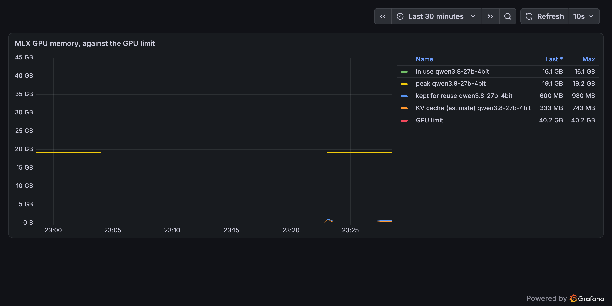
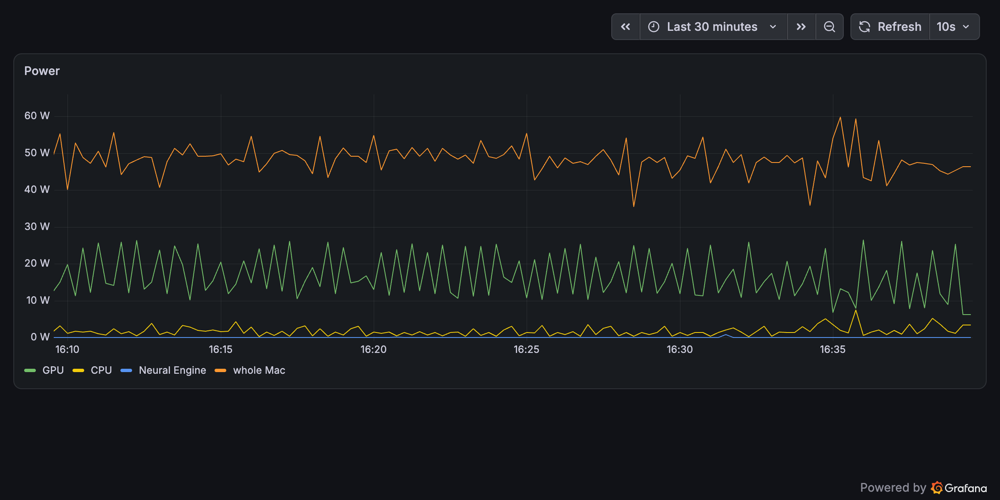
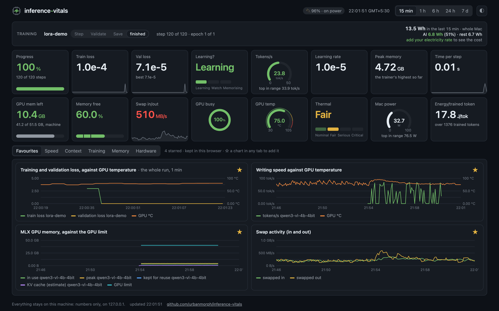
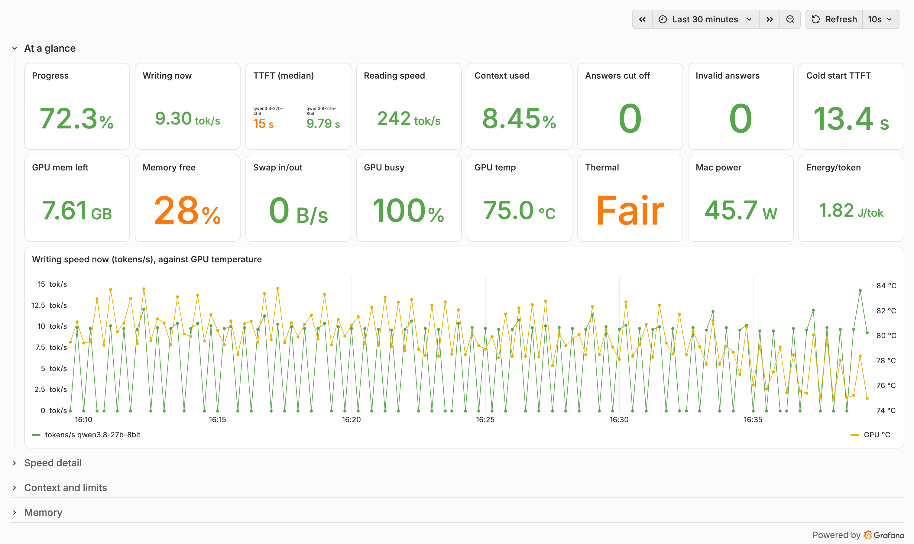

# The dashboard, tile by tile

[← README](../README.md)

## A model run

**At a glance**: a **Running** band naming each model that is reporting, what it is doing (Idle,
Reading (prefill) or Writing (decode)) and how far through its run it is; the **energy** the machine used
in the chosen time range and how much of it was the model's; then sixteen numbers, each drawn the way that
suits it (a progress bar, a speedometer, an arc with warning zones, a fill bar, a ring, steps for a state,
or a trend line where the pattern over time matters more than the reading now), and one chart:

| The run | The machine (Mac; differences on Linux below) |
| --- | --- |
| **Progress** through the current run | **GPU mem left**: the model's memory against macOS's limit for the GPU, when a run reports both (the library does); otherwise the memory left on the whole machine, which the GPU shares |
| **Writing now**: tokens per second, live, while the answer is written | **Memory free**, macOS's own memory-pressure level |
| **TTFT (median)**: time to first token | **Swap in/out**: bytes moving to and from swap right now |
| **Reading speed**: prompt tokens per second | **GPU busy** |
| **Context used** against the limit, live while the answer is written (prompt plus tokens so far) | **GPU temp** (amber at 85 °C, red at 95 °C) |
| **Answers cut off** at the token limit | **Thermal**: macOS's thermal state, live: Nominal, Fair (warm), Serious (slowing down), Critical |
| **Invalid answers** (not the format you asked for) | **Mac power**, the whole machine, in watts, against the highest in range |
| **Cold start TTFT**: the first answer after loading | **Energy/token**: the model's energy ÷ tokens written, over the chosen range |

On Linux with NVIDIA, the machine column changes where the hardware differs: **GPU mem left** is free
VRAM (summed over GPUs), **GPU slowdown** replaces Thermal (the GPU's own reasons for running below full
speed: None, Power cap, which is normal under full load, Thermal, Hardware), **GPU power** replaces Mac
power, and **Energy/token** counts the GPUs only. The folded sections show VRAM used against total per
GPU, GPU power against its limit, GPU and CPU temperatures, clocks, slowdown and fan speed.

The chart plots writing speed against GPU temperature, which is usually the first thing to look at
when a long run slows down. Every chart has a crosshair: point at any moment for each line's reading.

Below that, sections stay folded until you open them:

- **Speed detail**: TTFT per answer, median and 95th percentile, prefill and decode speed, model load time.
- **Context and limits**: context used per answer against the limit; prompt, cached and answer tokens.
- **Training**: loss, tokens per second, seconds per step, learning rate and memory of a fine-tune.
- **Memory**: model memory (in use, peak, kept for reuse, KV cache estimate) against the GPU limit;
  swap activity; memory pressure.
- **Hardware**: GPU, performance and efficiency core use; GPU, CPU, Neural Engine and whole-Mac power;
  temperatures; clock speeds; thermal state; fans.

| Memory, opened | Hardware, opened |
| --- | --- |
|  |  |

## A fine-tune

The page switches to a fine-tune on its own: whichever reported last, a model run or a fine-tune, is
shown. The band reads **Training**: the run's name, the phase of its step (Step, Validate, Save; and Read,
Backward or Write when the trainer reports them), step and epoch, and the time left. The run's tiles
become Progress (steps), **Train loss** and **Val loss** with their trend, **Learning?**, tokens trained
per second, learning rate, the trainer's peak memory and seconds per step; the machine tiles stay, with
energy per *trained* token.

**Learning?** reads Learning while validation loss still falls, Watch when it stops improving, and
**Memorising** when it rises while training loss still falls: the model is learning its examples by heart
rather than learning from them. The chart plots both losses against GPU temperature. The training charts
(this one and the folded Training section) span the latest run from its start to its end, or to now while
it runs, whatever range is chosen, so a one-minute run fills them as a two-hour one does. A finished fine-tune
stays on the page, marked finished, with its last numbers, until a model run reports (or for a week).
How to get a fine-tune on the page: [training.md](training.md).

## Energy and cost

The band adds up the power drawn over the chosen range (15 min to 7 days), in Wh or kWh, and splits it:
the **AI** share is the power above the machine's usual idle draw (the low end of the last day's readings)
while a model is reading or writing, or a fine-tune is training; the **rest** is everything else.
Energy/token is that AI energy divided by the tokens written (or trained) in the same range, so the
figures add up. Add your electricity rate (per kWh, or per unit, as on your bill) and it shows the
approximate cost of both; the rate stays in your browser. Tariffs vary by country, state, tier and time
of day, so the page never guesses one. On Linux only the GPUs are metered.

## Battery

On a laptop, a chip beside the clock shows the battery. On mains power it shows the charge
(`🔌 87% · on power`). On battery it shows the charge and how long it will last at the current load,
worked out from what the battery is giving right now, so it changes as soon as a run starts or stops
(`🔋 64% · ~2 h 0 min at this load`); it turns amber when the battery will run out before the run
finishes. On a machine with no battery it does not appear.

## Themes and address options

Light and dark follow your system; the ◐ button switches. The page's address takes a few options, handy
for bookmarks: `?range=` (`15m`, `1h`, `6h`, `24h`, `7d`), `?theme=` (`light`, `dark`) and `?open=`
(sections to show opened, e.g. `?open=memory,hardware`). The logo links back to the repository.

